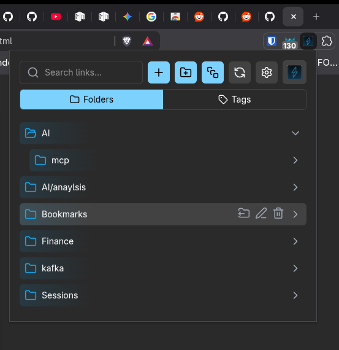
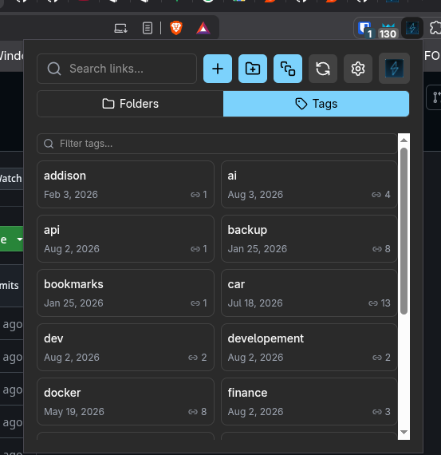
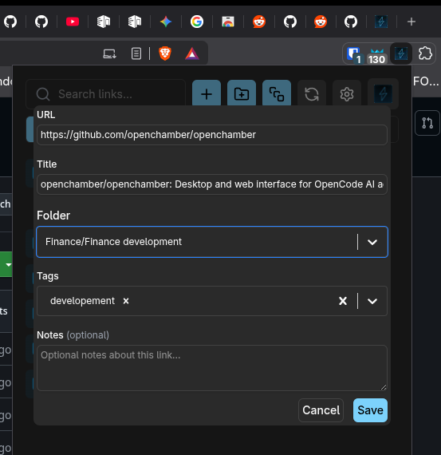
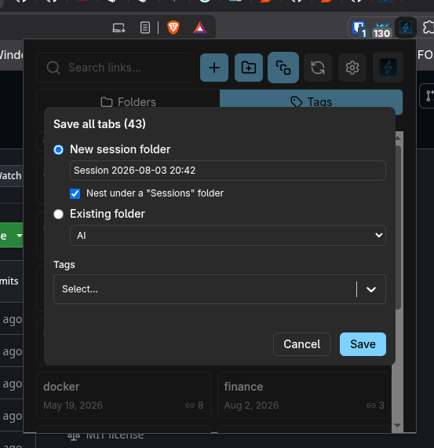
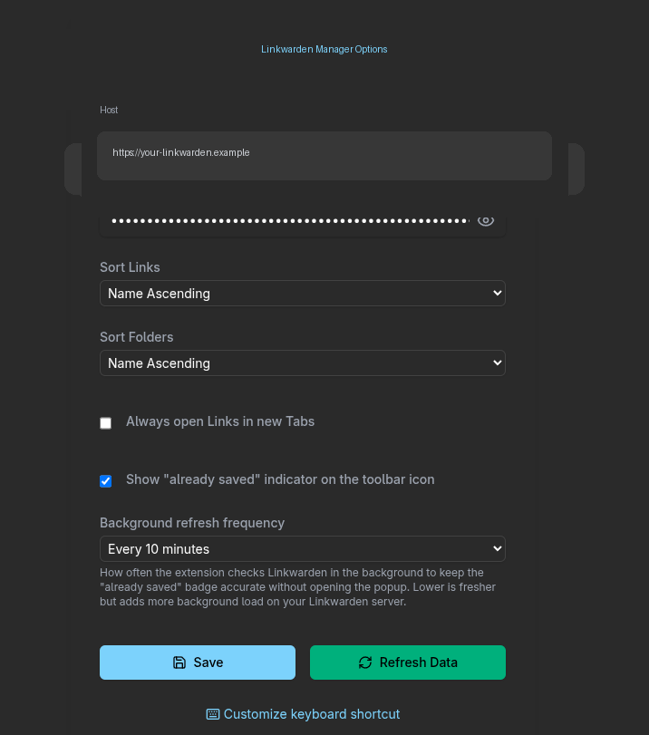
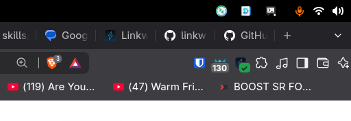

# Linkwarden Manager (Unofficial)

**Browse and manage your entire Linkwarden library from the browser toolbar.**

Unofficial community extension for [Linkwarden](https://linkwarden.app).  
**Not affiliated with or endorsed by Linkwarden.**

[](LICENSE)

---

## Why this exists

The [official Linkwarden extension](https://github.com/linkwarden/browser-extension) is great at **capturing** the current page. It is not a library browser.

**Linkwarden Manager** is the opposite bet: a full **popup client** for the library you already have — folders, tags, search, edit/delete, sessions, and keyboard power-user flows — without opening the web app for every tweak.

Use them together if you want. Use this alone if you live in the toolbar.

| | Official extension | **Linkwarden Manager** |
|---|---|---|
| Save current page | Yes | Yes (+ shortcut) |
| Screenshot upload | Yes | — |
| Username / password login | Yes | API key + host |
| Browse full folder tree | — | **Yes** |
| Nested path create (`AI/analysis`) | — | **Yes** |
| Tag browse, filter, counts | — | **Yes** |
| Search cached library | — | **Yes** |
| Edit / delete links | — | **Yes** |
| Drag & drop links between folders | — | **Yes** (spring-loaded folders) |
| Create / rename / delete folders | — | **Yes** |
| Save all tabs as a session folder | Yes | **Yes** (tags, nest under Sessions, or pick folder) |
| Open all links in a folder | — | **Yes** |
| “Already saved” toolbar badge | — | **Yes** (background refresh) |
| Works with self-hosted + cloud | Yes | **Yes** |


## Screenshots

<p align="center">
  
  
</p>

<p align="center">
  
  
</p>

<p align="center">
  
  
</p>

| | |
|---|---|
| **Folders** | Nested collections, colors/icons, hover actions |
| **Tags** | Multi-column cards, counts, latest date, filter |
| **Add link** | URL, title, folder (create inline), tags, notes |
| **Sessions** | Save every open tab to a new or existing folder |
| **Options** | Host, API token, appearance, sort, badge refresh, shortcut |
| **Badge** | Toolbar checkmark when the current page is already saved |

---

## Features

### Library in the popup
- **Folder tree** with expand/collapse, colors, and icons from Linkwarden
- **Tags pane** — multi-column cards, link counts, latest date, compact name filter
- **Search** across title, URL, notes, and tag names
- Cached locally for snappy open; refresh on demand or on an interval

### Real CRUD (not view-only)
- **Links:** add, edit, delete, tags, optional notes
- **Move links by dragging** them onto any folder row — hovering a closed folder springs it open, so nested targets take one gesture
- **Folders:** add, rename, reparent, delete
- **Path-aware create:** type `AI/analysis` to nest under an existing `AI` folder instead of a literal slash name
- Create a folder **inline** while saving a link

### Power-user flows
- **Keyboard shortcut** to save the current tab (default `Ctrl+Shift+S` / `⌘⇧S`)
- **Save all tabs** in the window as a session (new folder, nest under `Sessions`, or existing folder + tags)
- **Open all links** in a folder in a new window
- **Already-saved badge** on the toolbar icon, with configurable background refresh
- Sort links and folders independently (name / date)

### Looks the part
- **Light / Dark / System** appearance setting, matching Linkwarden's own three options — and the palette is Linkwarden's, token for token
- **All seven Linkwarden accent colours**, using its exact OKLCH values, so the popup matches the web app you already themed. (Linkwarden keeps the accent in browser storage rather than on your account, so it can't be synced — pick it once here.)
- **Folder icons follow your accent** — a folder you have never given a colour picks up the accent instead of Linkwarden's stock sky blue, so the whole tree matches. Colour a collection deliberately in Linkwarden and that colour is kept, here and there
- Compact popup UI aimed at daily use, not a one-shot save dialog
- **Resizable popup** — drag the bottom-left grip to enlarge it (up to the browser's 800×600 popup limit); the size is remembered, double-click resets it. Shrinking applies fully on the next open, since Chrome won't shrink a popup window that's already on screen

---

## Install (unpacked)

### Requirements
- A Linkwarden instance (cloud or self-hosted)
- An **API token** from Linkwarden
- Node.js + Yarn for building

### Build

```bash
git clone https://github.com/matthew-b-payne/linkwarden-manager.git
cd linkwarden-manager
yarn install
TARGET_BROWSER=CHROME yarn build    # or FIREFOX
```

Output lands in `dist/`.

### Chrome / Chromium / Edge / Brave
1. `chrome://extensions` → enable **Developer mode**
2. **Load unpacked** → select the `dist` folder

### Firefox
1. `TARGET_BROWSER=FIREFOX yarn build`
2. `about:debugging#/runtime/this-firefox` → **Load Temporary Add-on** → pick the built manifest under `dist`  
   (or install a signed `.xpi` from Releases when published)

### First-run setup
Open the extension **Options** and set:
- **Host** — e.g. `https://cloud.linkwarden.app` or your self-hosted URL  
- **API Token** — from Linkwarden settings  
- Optional: appearance (Light / Dark / System + accent colour), sort order, open-in-new-tab, badge refresh interval, keyboard shortcut link

On Chrome, saving prompts once for access to the host you entered — the extension
ships with no site access at all and asks only for that origin.

---

## Usage tips

| Goal | How |
|---|---|
| Jump the library | Open popup → search, or **Folders** / **Tags** tabs |
| Filter tags | Tags pane → compact **Filter tags…** (space/comma = OR) |
| Nest a folder | Add folder → name `Parent/Child` (reuses existing parent segments) |
| Reorganize links | Drag a link onto another folder row (hold over a closed folder to open it) |
| Make the popup bigger | Drag the grip in its bottom-left corner (double-click to reset) |
| Save without opening popup | `Ctrl+Shift+S` / `⌘⇧S` (customize in browser shortcut settings) |
| Bulk-save a research window | **Save all tabs** → session folder + tags |
| Spot duplicates | Enable **already saved** badge in Options |

---

## Build targets

```bash
TARGET_BROWSER=CHROME yarn build
TARGET_BROWSER=FIREFOX yarn build
```

Always leave `dist/` as the browser you intend to load next (Chrome last if you dual-build).

---

## Project status

Actively used and extended. Core library manage flows are solid; see [`CHANGELOG.md`](CHANGELOG.md) for recent work (theming, tag browse, path folders, sessions, badge, shortcuts).

### Not a goal (yet)
- Replacing the official “save + screenshot” capture UX pixel-for-pixel  
- Mobile  
- Non-Linkwarden backends (architecture allows it; not shipped)

---

## Disclaimer

This is an **unofficial** community project.  
It is **not** the official Linkwarden browser extension and is **not affiliated with, endorsed by, or supported by** the Linkwarden project or its authors.

- Official app: [linkwarden.app](https://linkwarden.app)  
- Official extension: [linkwarden/browser-extension](https://github.com/linkwarden/browser-extension)

Use at your own risk with your own API token and instance.

What the extension stores and what leaves your machine: [`PRIVACY.md`](PRIVACY.md).

---

## Credits

Forked from community Linkwarden browser work (originally based on earlier open-source starters). Heavily extended for library management, tags, sessions, theming, and UX.

## License

[MIT](LICENSE)
